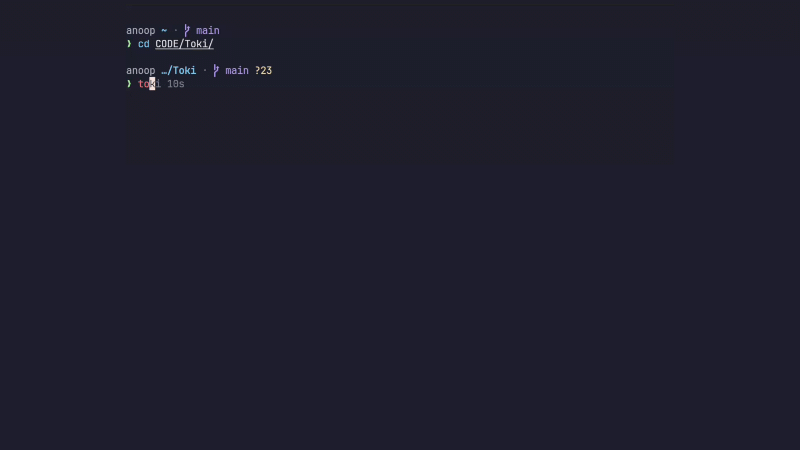

# Toki

A simple study timer for **Linux and macOS**. Set a countdown or study for as
long as you like. Pause anytime, take a calculated break, and check your study totals.



- Live progress bar and pause/resume.
- Optional spoken audio cues.
- Stats for today, the last seven days, and this month.
- Local storage only. No account, network access, or Python packages needed to run.

## 1. Install the requirements

You need **Python 3.10+**, **Fish 3.6+**, and **Git**. Choose your system:

**Ubuntu / Debian**

```sh
sudo apt update
sudo apt install python3 fish git
```

**Fedora**

```sh
sudo dnf install python3 fish git
```

**Arch Linux**

```sh
sudo pacman -S python fish git
```

**macOS** — install [Homebrew](https://brew.sh/) first if you do not have it.

```sh
brew install python fish git
```

## 2. Install Toki

```sh
git clone https://github.com/Czar-16/Toki.git ~/Toki
cd ~/Toki
python3 install.py
```

Keep the `Toki` folder: the installed commands use its files. You can clone
it somewhere else; run the installer again if you move it.

## 3. Start studying

Open a new terminal tab and enter Fish:

```sh
fish
```

Then run:

```fish
toki          # Choose a duration, or press Enter for open-ended study.
toki 25       # Study for 25 minutes.
toki 30s      # Study for 30 seconds.
toki 1.5h     # Study for 90 minutes.
toki stats    # See your study totals.
toki --help   # Quick help.
```

Press **Enter** at the start prompt to begin.

| Key | Action |
| --- | --- |
| **Space** or **p** | Pause / resume. |
| **Enter** | Finish an open-ended session. |
| **q** or **Ctrl+C** | Stop the current timer. Studied time is saved. |

After work, Toki offers a break equal to 20% of your active study time, capped
at 30 minutes. Press Enter to start it. At `Continue?`, press Enter for
another session or type `n` to finish.

**You do not need to change your default shell.** If you prefer bash or zsh,
use `~/.local/bin/toki` in place of `toki`, for example `~/.local/bin/toki 25`.
Toki works in a normal terminal; Kitty and cursor animations are optional.

## Study stats

```text
Today:          02h 35m 18s
Last 7 days:    14h 22m 46s
This month:     42h 10m 05s
```

Only active study time counts, including sessions stopped early. Pauses and
breaks do not count. Data is saved every five seconds and when pausing or
stopping; a forced termination can lose the unsaved interval.

Stats stay in `~/.local/share/toki/stats.json` by default. They take only a
few KB, with at most 31 daily totals. On the first use of a new month, old
months are deleted automatically. The seven-day total includes only dates
still in the current month. Tracking begins when you first use Toki.

## Sound (optional)

macOS uses its built-in `afplay`. On Linux, Toki uses an installed player
such as `paplay`, `ffplay`, `mpv`, or `aplay`. If none is available, it runs
silently. To add sound on Ubuntu/Debian:

```sh
sudo apt install ffmpeg
```

To run quietly on either system:

```sh
env TOKI_SOUND=0 ~/.local/bin/toki 25
```

## Update or uninstall

Update from the folder where you cloned Toki:

```sh
cd ~/Toki
git pull --ff-only
python3 install.py
```

Uninstall the commands while keeping your study stats:

```sh
cd ~/Toki
python3 install.py --uninstall
```

Then open a new terminal tab. You can delete the checkout after uninstalling.
To permanently delete your saved stats as well, delete the `toki` data folder
shown above. If you configured a custom data location, use that location.

## Need help?

- **`toki: command not found`:** open a new Fish tab, or run `~/.local/bin/toki`.
- **Missing or old Python/Fish:** check `python3 --version` and `fish --version`.
  Older Linux releases may need newer packages from their official repositories.
- **Installer reports existing files:** it leaves them untouched. Run
  `python3 install.py --force` to back them up and install Toki.
- **No sound:** install an audio player, check your volume, or use silent mode.

See [all commands](COMMANDS.md), [contributing](CONTRIBUTING.md), or
[open an issue](https://github.com/Czar-16/Toki/issues).

## License and credits

[MIT licensed](LICENSE). Built on
[mohsince-04/fish-flowmodoro](https://github.com/mohsince-04/fish-flowmodoro).
See [attribution](THIRD_PARTY_NOTICES.md) for the original code and audio credits.
